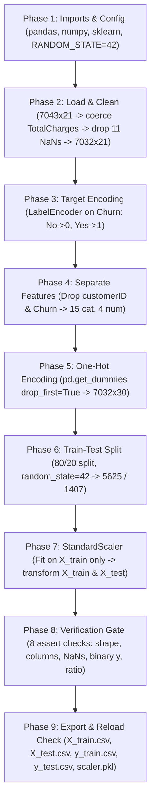

# Automated ML Data Preprocessor — Telco Customer Churn Pipeline

An end-to-end, leak-free data preprocessing pipeline built in Python (`Week5_Telco_Churn_Preprocessing_Pipeline.ipynb`) that transforms the raw **IBM Telco Customer Churn** dataset into validated, model-ready train/test splits and a serialized feature scaler for downstream ML modeling (Week 6).


---

## Table of Contents

- [Overview](#overview)
- [Dataset Summary & Shape Progression](#dataset-summary--shape-progression)
- [Pipeline Architecture (9 Phases)](#pipeline-architecture-9-phases)
- [Key Engineering & ML Design Decisions](#key-engineering--ml-design-decisions)
- [Pre-Export Verification Gate](#pre-export-verification-gate)
- [Exported Artifacts & Observed Results](#exported-artifacts--observed-results)
- [Downstream Usage (Week 6 Handoff)](#downstream-usage-week-6-handoff)
- [How to Run](#how-to-run)
- [Repository Structure](#repository-structure)

---

## Overview

Raw tabular datasets commonly arrive with string-typed numeric fields, unique identifier columns, mixed categorical/numerical predictors, and unscaled continuous features. Feeding such data directly into machine learning models causes runtime failures, multicollinearity, and data leakage.

This notebook automates a reproducible **9-phase preprocessing workflow** with `RANDOM_STATE = 42`:

1. Loads the IBM Telco Customer Churn CSV directly from source.
2. Coerces malformed billing strings to numeric and drops incomplete onboarding rows.
3. Encodes the binary target (`Churn`) while verifying class label mapping.
4. Separates identifier, target, categorical, and numerical columns.
5. One-hot encodes all categorical predictors with reference-level dropping (`drop_first=True`).
6. Partitions the dataset into an 80/20 train–test split.
7. Standardizes continuous numerical features using `StandardScaler` fit **strictly on training data**.
8. Enforces data integrity through an **8-assertion verification gate**.
9. Exports clean CSV splits, reloads them to verify schema parity, and persists `scaler.pkl` via `joblib`.

---

## Dataset Summary & Shape Progression

- **Source:** [IBM Telco Customer Churn Dataset](https://raw.githubusercontent.com/IBM/telco-customer-churn-on-icp4d/master/data/Telco-Customer-Churn.csv)
- **Target Variable:** `Churn` (`No` → `0`: 5,163 rows | `Yes` → `1`: 1,869 rows | Churn Rate: `0.2658`)

| Stage | Shape | Description |
| --- | --- | --- |
| **Raw CSV** | `(7043, 21)` | `customerID` + 19 input features + `Churn` |
| **After Cleaning (`TotalCharges`)** | `(7032, 21)` | Dropped 11 rows with blank `TotalCharges` (`tenure = 0`); 0 duplicate IDs |
| **Feature Separation (`X_raw`)** | `(7032, 19)` | Removed `customerID` and `Churn` (15 `object` + 4 numeric features) |
| **One-Hot Encoding (`X`)** | `(7032, 30)` | 4 numeric + 26 binary dummy columns (`0` NaNs, `0` non-numeric columns) |
| **Training Split (`X_train`, `y_train`)** | `(5625, 30)` / `(5625,)` | 80% partition (`y_train` churn rate: `0.2658`) |
| **Testing Split (`X_test`, `y_test`)** | `(1407, 30)` / `(1407,)` | 20% partition (`y_test` churn rate: `0.2658`) |

### Feature Breakdown (`X_raw`)

- **Identifier Dropped (1):** `customerID`
- **Target Extracted (1):** `Churn`
- **Categorical Features (15):** `gender`, `Partner`, `Dependents`, `PhoneService`, `MultipleLines`, `InternetService`, `OnlineSecurity`, `OnlineBackup`, `DeviceProtection`, `TechSupport`, `StreamingTV`, `StreamingMovies`, `Contract`, `PaperlessBilling`, `PaymentMethod`
- **Numerical Features (4):**
  - Binary indicator (unscaled): `SeniorCitizen`
  - Continuous features (z-score scaled): `tenure`, `MonthlyCharges`, `TotalCharges`

---

## Pipeline Architecture (9 Phases)



| Phase | Notebook Section | Core Operations | Key Output / Check |
| --- | --- | --- | --- |
| **Phase 1** | Imports & Global Styling | Load `pandas`, `numpy`, `LabelEncoder`, `StandardScaler`, `train_test_split`; set `RANDOM_STATE = 42` | Environment initialized |
| **Phase 2** | 1. Load & Clean | `pd.read_csv(URL)`, `pd.to_numeric(..., errors="coerce")`, `dropna(subset=["TotalCharges"])` | `11` blanks dropped; `(7032, 21)`; `0` duplicates |
| **Phase 3** | 2. Target Encoding | `LabelEncoder().fit_transform(df["Churn"])` | `{'No': 0, 'Yes': 1}`; churn rate `0.2658` |
| **Phase 4** | 3. Feature Set | Drop `customerID`, `Churn`; detect `object` vs. numeric columns | `15` categorical, `4` numerical (`(7032, 19)`) |
| **Phase 5** | 4. Categorical Encoding | `pd.get_dummies(X_raw, columns=cat_cols, drop_first=True, dtype=int)` | `(7032, 30)`, `0` non-numeric cols, `0` NaNs |
| **Phase 6** | 5. Train–Test Partitioning | `train_test_split(X, y, test_size=0.2, random_state=42)` | Train `5,625` / Test `1,407`; mean `0.2658` in both |
| **Phase 7** | 6. Z-Score Feature Scaling | `StandardScaler()` fit on `X_train[SCALE_COLS]`, transform train & test | Train mean `0.0`, std `1.0` |
| **Phase 8** | 7. Artifact Verification | 8 programmatic `assert` statements | `✅ All 8 checks passed` |
| **Phase 9** | 8. Structured Export | Export 4 CSVs (`index=False`), reload check, `joblib.dump(scaler, "scaler.pkl")` | `Columns match original: True` |

---

## Key Engineering & ML Design Decisions

1. **Handling Blank `TotalCharges` Strings (`11` Rows Dropped)**
   `TotalCharges` is parsed as `object` in the raw CSV because 11 newly onboarded customers (`tenure = 0`) contain whitespace strings instead of numbers. Converting with `errors="coerce"` and dropping those 11 rows removes incomplete billing records without distorting customer tenure or charge distributions.

2. **`LabelEncoder` Restricted Strictly to the Target (`Churn`)**
   `LabelEncoder` is applied **only** to `y` (`Churn`), never to input features. Using `LabelEncoder` on non-ordinal predictors introduces artificial numeric ordering (e.g., implying `"DSL < Fiber < None"`). Because `LabelEncoder` orders classes alphabetically, the notebook explicitly prints and verifies `{'No': 0, 'Yes': 1}`.

3. **One-Hot Encoding with `drop_first=True` Before Splitting**
   - `drop_first=True` drops one reference category per feature to eliminate perfect multicollinearity (the dummy variable trap), keeping linear and logistic models numerically stable.
   - `pd.get_dummies(..., dtype=int)` is executed across `X_raw` prior to `train_test_split` so `X_train` and `X_test` are guaranteed to share the exact same 30 columns and ordering, avoiding missing-level column mismatches between splits without leaking target or distribution statistics.

4. **Exclusion of `customerID` and Binary `SeniorCitizen` Scaling**
   - `customerID` is dropped before encoding because unique identifiers carry zero predictive signal and encourage row memorization.
   - `SeniorCitizen` is omitted from `SCALE_COLS = ["tenure", "MonthlyCharges", "TotalCharges"]` because it is already a clean `0`/`1` binary flag.

5. **Leak-Free `StandardScaler` Fit Discipline**
   `scaler.fit_transform()` runs **exclusively on `X_train[SCALE_COLS]`**, while `X_test[SCALE_COLS]` is transformed using `scaler.transform()`. Fitting on the combined dataset would leak test-set mean and standard deviation into training and artificially inflate downstream evaluation metrics.

---

## Pre-Export Verification Gate

Before any file is written to disk, Phase 8 enforces 8 assertions:

| # | Assertion Check | Purpose |
| --- | --- | --- |
| 1 | `X_train_scaled.shape[1] == X_test_scaled.shape[1]` | Confirms identical feature counts across splits |
| 2 | `list(X_train_scaled.columns) == list(X_test_scaled.columns)` | Confirms identical column names and ordering |
| 3 | `X_train_scaled.isna().sum().sum() == 0` | Ensures zero missing values in training features |
| 4 | `X_test_scaled.isna().sum().sum() == 0` | Ensures zero missing values in testing features |
| 5 | `len(X_train_scaled) == len(y_train)` | Validates training feature–target row alignment |
| 6 | `len(X_test_scaled) == len(y_test)` | Validates testing feature–target row alignment |
| 7 | `set(y_train.unique()) == {0, 1}` | Confirms binary target integrity |
| 8 | `0.75 <= len(X_train_scaled) / len(X) <= 0.85` | Verifies the 80/20 split ratio |

---

## Exported Artifacts & Observed Results

### Z-Score Scaling Statistics (`ddof=0`)

| Feature | `X_train` Scaled Mean | `X_train` Scaled Std | `X_test` Scaled Mean | `X_test` Scaled Std |
| --- | --- | --- | --- | --- |
| `tenure` | `-0.0` | `1.0` | `0.0176` | `1.0016` |
| `MonthlyCharges` | `-0.0` | `1.0` | `0.0167` | `0.9853` |
| `TotalCharges` | `0.0` | `1.0` | `0.0177` | `1.0037` |

### Generated Output Files

| Artifact | Shape / Type | Observed Size | Purpose |
| --- | --- | --- | --- |
| `X_train.csv` | `(5625, 30)` | `619.7 KB` | Encoded & scaled training feature matrix (`index=False`) |
| `X_test.csv` | `(1407, 30)` | `155.5 KB` | Encoded & scaled testing feature matrix (`index=False`) |
| `y_train.csv` | `(5625,)` | `11.0 KB` | Binary training target labels (`0` / `1`, `index=False`) |
| `y_test.csv` | `(1407,)` | `2.8 KB` | Binary testing target labels (`0` / `1`, `index=False`) |
| `scaler.pkl` | `StandardScaler` | — | Fitted `StandardScaler` serialized with `joblib` for inference |

All four CSVs are reloaded in Phase 9 and verified to match the in-memory column schema (`Columns match original: True`).

---

## Downstream Usage (Week 6 Handoff)

Load the preprocessed splits and serialized scaler directly in downstream model training or inference scripts:

```python
import joblib
import pandas as pd

X_train = pd.read_csv("X_train.csv")
X_test = pd.read_csv("X_test.csv")
y_train = pd.read_csv("y_train.csv").squeeze("columns")
y_test = pd.read_csv("y_test.csv").squeeze("columns")

scaler = joblib.load("scaler.pkl")
# Reuse scaler.transform(new_data[["tenure", "MonthlyCharges", "TotalCharges"]]) for live inference
```

---

## How to Run

### Option 1: Google Colab (Recommended)
1. Upload `Week5_Telco_Churn_Preprocessing_Pipeline.ipynb` to [Google Colab](https://colab.research.google.com/).
2. Select **Runtime → Run all**.
3. Download the generated `X_train.csv`, `X_test.csv`, `y_train.csv`, `y_test.csv`, and `scaler.pkl` files from the Colab file browser.

### Option 2: Local Jupyter Environment
```bash
pip install pandas numpy scikit-learn joblib jupyter
jupyter notebook Week5_Telco_Churn_Preprocessing_Pipeline.ipynb
```
Run all cells sequentially (requires internet access to fetch the IBM Telco Customer Churn CSV in Phase 2).

---

## Repository Structure

```text
.
├── Week5_Telco_Churn_Preprocessing_Pipeline.ipynb   # 9-phase automated preprocessing notebook
├── README.md                                        # Project documentation & verification summary
├── X_train.csv                                      # Generated training features (5625 x 30)
├── X_test.csv                                       # Generated testing features (1407 x 30)
├── y_train.csv                                      # Generated training labels (5625,)
├── y_test.csv                                       # Generated testing labels (1407,)
└── scaler.pkl                                       # Persisted StandardScaler for Week 6 inference
```
